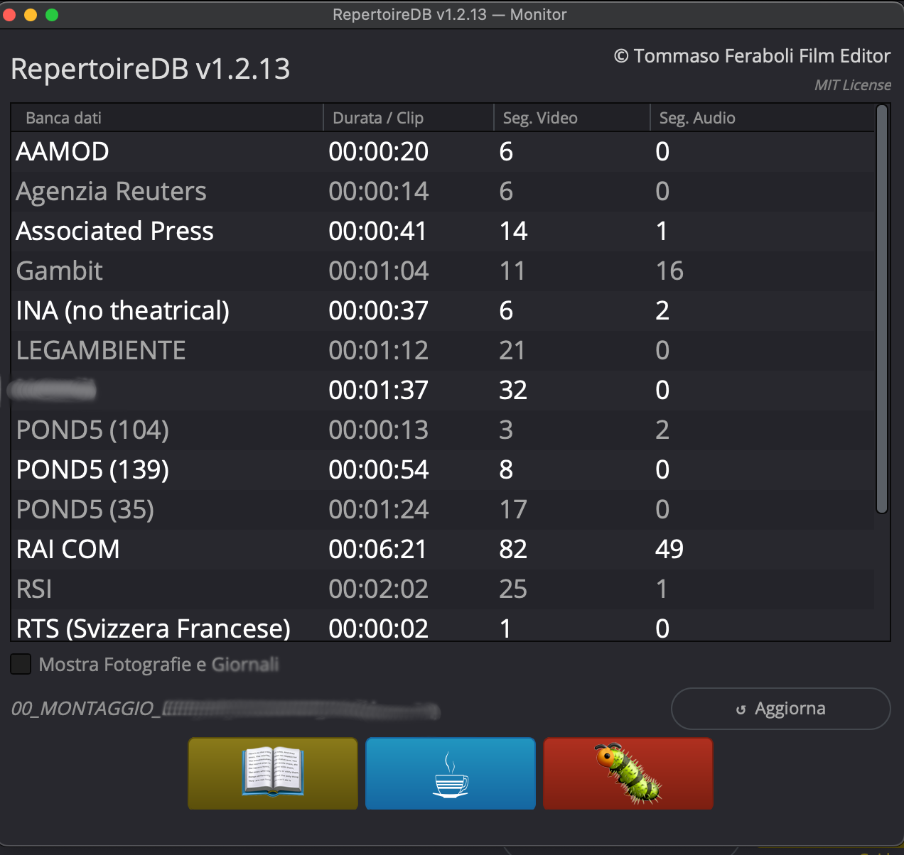

# RepertoireDB

**Calcolo dei costi del materiale di repertorio per DaVinci Resolve.**
Legge la timeline e dice quanto costa il repertorio che c'è dentro.

🇬🇧 [Read in English](README.md)

  
   
  <em>Il Monitor: quanto hai usato di ogni banca dati, mentre monti</em>

<!-- Manca ancora: docs/images/calculator.png (il preventivo).
     Farlo su un progetto DI PROVA, mai su una produzione vera: quella finestra
     mostra i costi per clip, il totale della produzione e i nomi dei file, e da
     un costo accanto a una durata chiunque ricava la tariffa di un archivio —
     cioè esattamente quello che questo repository evita di pubblicare. -->

---

## Il problema che risolve

In un documentario con molto repertorio, calcolare i costi delle licenze è lento
e si sbaglia facilmente. Ogni archivio ha il suo modello di prezzo — al secondo,
al minuto, a clip, a blocchi, a forfait — ognuno con le sue regole di sconto e il
suo minimo fatturabile. E il montaggio cambia fino all'ultimo giorno.

Farlo a mano significa un foglio di calcolo che è già vecchio appena accorci
un'inquadratura.

RepertoireDB legge direttamente la timeline: tagghi i clip con l'archivio di
provenienza e lui produce il conteggio. Quando il montaggio cambia, lo rilanci.

Scritto da un montatore per i propri documentari.

---

## Cosa fa

Tre script che lavorano insieme:

| Script | A cosa serve |
|---|---|
| **Config** | Il tuo archivio di banche dati: modelli di prezzo, tariffe, sconti, utilizzo minimo |
| **Calculator** | Legge una timeline e produce il preventivo completo |
| **Monitor** | Una finestrella flottante: quanto hai usato di ogni banca, a colpo d'occhio, mentre monti |

### Il Monitor, in pratica

Quasi sempre non ti serve un preventivo: ti serve sapere se sei ancora dentro
i minuti che hai licenziato. Il Monitor è una finestrella che tieni aperta di
fianco alla timeline: una riga per banca dati, con la **durata totale usata** e
da quanti segmenti video e audio arriva.

Niente arrotondamenti, niente sconti, niente fattura: solo le durate,
aggiornate quando premi Aggiorna. Risponde alla domanda che ti fai venti volte
al giorno — *quanto sto usando di questo archivio?* — senza far partire il
calcolo completo.

Cliccando il nome di una banca, tutti i suoi clip vengono flaggati in timeline
e selezionati: vedi subito dove sta quel materiale nel montaggio.

Quando servono i numeri veri, c'è il Calculator.

**Modelli di prezzo**: a clip · al secondo · al minuto · a blocchi personalizzati ·
forfait (il video li usa tutti; fotografie e giornali usano a clip o forfait)

**Gestisce anche:**

- **Sconti** — progressivi (solo sull'eccedenza) o flat (su tutto), con soglia in
  secondi o in numero di clip
- **Riconoscimento dei duplicati** — se gli stessi fotogrammi sorgente compaiono
  due volte nel montaggio, vengono conteggiati una volta sola
- **Retime** — rileva slow motion, time warp, freeze frame e reverse
- **Utilizzo minimo** — quando l'uso effettivo sta sotto il minimo fatturabile
  dell'archivio, il report mostra la differenza
- **Audio eccedente** — l'audio usato oltre la copertura video è conteggiato al 50%
- **Esportazione** — report completo in CSV o Excel (`.xlsx`)

> **I numeri sono indicativi.** Il report è un calcolo di lavoro, non la
> contabilità ufficiale della produzione. Le condizioni contrattuali variano e
> hanno sempre la precedenza.

---

## Installazione

Scarica l'installer per il tuo sistema dalla
[pagina Releases](../../releases), poi:

**macOS** — **clic destro** sul file `.command` e scegli **Apri**
(non doppio clic: l'installer non è firmato con un certificato Apple, e il
doppio clic viene bloccato).

**Windows** — doppio clic sul file `.cmd`. Se SmartScreen avvisa, scegli
*Ulteriori informazioni* → *Esegui comunque*.

L'installer mette i file nelle due posizioni che servono a Resolve e avvisa
quando ha finito. Poi, in Resolve:

    Workspace > Scripts > Comp > RepertoireDB_Config

Se installi a mano: gli script in `scripts/` vanno in
`Fusion/Scripts/Comp/RepertoireDB/`, i due moduli in `modules/` vanno in
`Fusion/Modules/Lua/` — **due cartelle diverse**. Con i moduli nel posto
sbagliato gli script non partono.

---

## Requisiti

- **DaVinci Resolve Studio 19 o 20.** La versione gratuita non funziona: dalla
  19.1 l'interfaccia di scripting su cui sono costruiti questi strumenti
  (UIManager) è solo per Studio.
- macOS o Windows
- Solo per l'esportazione in Excel: Python 3 con `openpyxl` (c'è uno script di
  supporto, `RepertoireDB_Installer.lua`, che lo prepara)

---

## Limiti noti

- **Solo Studio** — vedi sopra
- **Clip retimati**: il timecode su clip molto retimati o a velocità variabile
  può essere approssimato; dove Resolve non riporta la velocità, il calcolo
  assume il 100%
- **Frame rate inusuali**: frame rate non standard o variabili danno risultati
  approssimati
- **Windows**: il codice è cross-platform e l'installer è fatto per entrambi i
  sistemi, ma l'uso quotidiano è provato su macOS
- Lo strumento legge quello che c'è in timeline. Non può sapere nulla di
  condizioni contrattuali che non hai inserito nel database delle banche dati

---

## Documentazione

- [Manuale utente](docs/) — la guida completa
- [CHANGELOG](CHANGELOG.md) — cosa è cambiato in ogni versione

---

## Segnalare un problema

Apri una [Issue](../../issues) — è il modo migliore, perché chi ha lo stesso
problema trova la risposta già scritta.

Gli script hanno anche un pulsante 🐛 che apre una mail precompilata con i
dettagli del sistema, e tengono un file di log che puoi allegare:

- macOS: `~/Library/Logs/RepertoireDB/repertoire_db.log`
- Windows: `%LOCALAPPDATA%\Blackmagic Design\DaVinci Resolve\Logs\RepertoireDB\`

Una nota su cosa hai davanti: questi script li scrive un montatore, non uno
sviluppatore di professione. Il codice funziona e viene usato su produzioni vere,
ma non aspettarti le convenzioni di un progetto software.

---

## Crediti

**Tommaso Feraboli** — Film Editor
Distribuito con licenza [MIT](LICENSE.md) · Copyright (c) 2024-2026

Se ti fa risparmiare tempo: [offrimi un caffè](https://paypal.me/acoffeefortom) ☕
