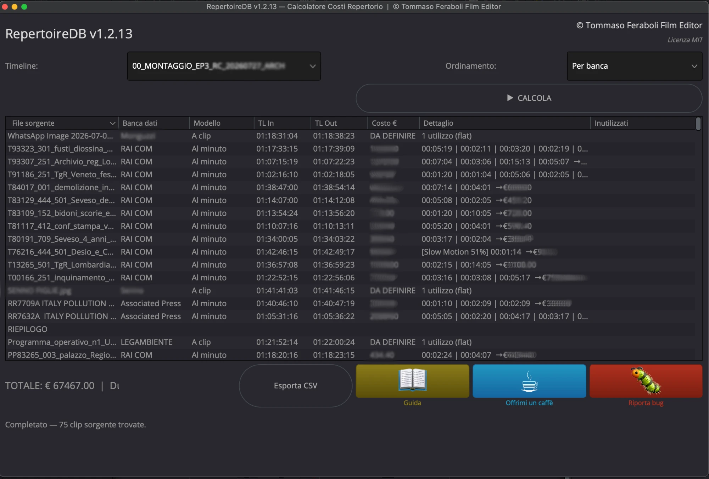

# RepertoireDB

**Archive footage cost calculator for DaVinci Resolve.**
Reads your timeline and works out what the archive material in it will cost.

🇮🇹 [Leggi in italiano](README.it.md)

  
   
  <em>The Calculator — the cost report (figures blurred: this is a real production)</em>

  
   
  <em>The Monitor — how much you have used from each archive, while you edit</em>

<!-- Both screenshots come from a real production, with rates and supplier
     names blurred out. If you replace them, take the new ones on a TEST
     project: the Calculator window shows per-clip costs next to durations,
     and from that pair anyone can work out an archive's rate — which is
     exactly what this repository is careful not to publish. -->

---

## The problem this solves

On an archive-heavy documentary, working out licensing costs is slow and
error-prone. Every archive has its own pricing model — per second, per minute,
per clip, in blocks, or a flat fee — each with its own discount rules and
minimum billable duration. And the cut keeps changing until the last day.

Doing this by hand means a spreadsheet that is out of date the moment you trim
a shot.

RepertoireDB reads the timeline directly: you tag each clip with the archive it
came from, and it produces the cost breakdown. When the cut changes, you run it
again.

Written by a working film editor, for his own documentaries.

---

## What it does

Three scripts that work together:

| Script | What it is for |
|---|---|
| **Config** | Your archive database: pricing models, rates, discounts, minimum usage |
| **Calculator** | Reads a timeline and produces the full cost report |
| **Monitor** | A small floating window: how much you have used from each archive, at a glance, while you edit |

### The Monitor, in practice

Most of the time you don't need a cost report — you need to know whether you
are still inside the minutes you have licensed. The Monitor is a small window
you leave open next to the timeline: one line per archive, with the **total
duration used**, and how many video and audio segments it comes from.

No rounding, no discounts, no invoice: just the durations, updated when you
press Refresh. It answers the question you actually ask yourself twenty times
a day — *how much of this archive am I using?* — without running the full
calculation.

Click an archive name and every clip from it gets flagged in the timeline and
selected, so you can see at once where that material is in the cut.

When you need the real figures, that is what the Calculator is for.

**Pricing models**: per clip · per second · per minute · custom blocks · flat fee
(video supports all of them; photo and newspaper archives use per clip or flat fee)

**It also handles:**

- **Discounts** — tiered (only on the excess) or flat (on everything), with the
  threshold set in seconds or in number of clips
- **Duplicate detection** — if the same source frames appear twice in the cut,
  they are billed once
- **Retiming** — detects slow motion, time warp, freeze frames and reverse
- **Minimum billable duration** — when actual usage falls below an archive's
  minimum, the report shows the gap
- **Audio beyond video coverage** — audio-only usage billed at 50%
- **Language** — English or Italian, picked in `Config`, or left on
  **Automatic**, which follows your operating system's language (not DaVinci
  Resolve's: those are two different settings). The interface, the CSV estimate
  and the Excel sheet all follow it
- **Currency** — pick the symbol amounts are shown with (euro, dollar, pound,
  Swiss franc, Canadian and Australian dollar, yuan, yen, won). It changes the
  symbol only: **nothing is converted**, and no exchange rate is applied
- **Export** — a full report to CSV or Excel (`.xlsx`)

**The Excel file is not a snapshot of the numbers: it is a spreadsheet that
keeps working.** The export produces three sheets linked by live formulas —
`Config` with the archives, `Segmenti` with the clips, `Riepilogo` with the
totals. Change a rate or a discount percentage in the `Config` sheet, and every
clip cost and every total recalculates on its own. No need to reopen Resolve or
run the script again.

Useful when the cut is locked but the negotiation is not: try two different
rates in front of the producer and see straight away where the estimate lands.

### What recalculates in the sheet, and what does not

Not everything in the sheet is a formula, and the difference matters.

| | |
|---|---|
| **Recalculates** | rates, discount percentages and their thresholds, minimum billable duration, block length — the commercial terms, the numbers you negotiate over |
| **Does not recalculate** | the billable source durations, and which occurrences are repeats of material already paid for — these are measurements taken by reading the cut |

This is a real limit of a spreadsheet, not a shortcut. To know whether the same
source frames appear twice in the cut you have to compare the ranges of every
clip of that archive against each other, partial overlaps included. A formula
can add up; it cannot recognise. So those values arrive from the Calculator as
established facts, written into cells the sheet does not recompute.

**What this means in practice:** editing a segment's timecodes by hand in the
`Segmenti` sheet does **not** change the cost, and deleting or adding segment
rows does not produce a consistent count. When the cut changes, run the
Calculator again and re-export. The sheet is for negotiating rates, not for
correcting the cut.

> **The figures are indicative.** The report is a working estimate, not the
> production's official costing. Contractual terms vary and always take
> precedence.

---

## Installation

Download the installer for your system from the
[Releases page](../../releases), then:

**macOS** — two steps, because macOS puts two different obstacles in the way:

1. **Double-click the zip** to unpack it. Downloading a file over the web
   strips its Unix permissions, so the installer arrives unable to run. Inside
   the zip the permission survives.
2. **Right-click** the unpacked `.command` file and choose **Open** — not a
   double-click. The installer is not signed with an Apple certificate, and
   only this way do you get the dialog with the Open button.

**Windows** — double-click the `.cmd` file. If SmartScreen warns you, choose
*More info* → *Run anyway*.

The installer puts the files in the two places Resolve needs them and tells you
when it is done. Then, in Resolve:

    Workspace > Scripts > Comp > RepertoireDB_Config

Installing manually? The scripts in `scripts/` go in
`Fusion/Scripts/Comp/RepertoireDB/`, and the four modules in `modules/` go in
`Fusion/Modules/Lua/` — **two different folders**. The scripts will not start if
`LogManager.lua`, `BugReportDialog.lua` or `Settings.lua` are in the wrong
place. `Strings.lua`, which holds the English translation, is the one exception:
without it the interface simply stays in Italian.

---

## Requirements

- **DaVinci Resolve Studio 19 or 20.** The free version will not work: since
  Resolve 19.1 the scripting interface these tools are built on (UIManager) is
  Studio-only.
- **English and Italian.** Since 1.4.0 the interface, the CSV estimate and the
  exported Excel sheet are available in English. On first run the language
  follows your operating system; you can also set it explicitly in `Config`.
  Amounts are not euro-only either: pick the currency symbol in `Config`. It is
  a symbol, not a conversion — enter your rates in the currency you actually
  license in.
- macOS or Windows
- For Excel export only: Python 3 with `openpyxl` (there is a helper script,
  `RepertoireDB_Installer.lua`, that sets this up)

---

## Known limits

- **Studio only** — see above
- **Retimed clips**: timecode on heavily retimed or variable-speed clips can be
  approximate; the calculation assumes 100% speed where Resolve does not report
  otherwise
- **Unusual frame rates**: non-standard or variable frame rates give approximate
  results
- **Windows**: the code is cross-platform and the installer is built for both,
  but day-to-day use is tested on macOS
- **The exported Excel sheet cannot recognise repeated material on its own** —
  it receives that information from the Calculator. Edits to the `Segmenti`
  sheet that would change which material is billable are therefore not
  reflected in the totals. See *What recalculates in the sheet, and what does
  not* above
- **One currency at a time.** The currency setting is a symbol for the whole
  database. If you license from archives in different currencies in the same
  project, convert the rates yourself before entering them
- **The values stored in your configuration file stay in Italian** — `A clip`,
  `Al minuto`, `Video`, `Fotografie`. This is deliberate, not an oversight:
  those words are the key the tool uses to find each archive's pricing model,
  and they are also the format of the `Model` column in the import CSVs. Keeping
  them means a database built in English opens in Italian and the other way
  round. You see the translated label on screen; the file keeps the key.
  The Config sheet's own CSV export keeps them too, because it is meant to be
  re-imported — including into someone else's copy, in whatever language
- The tool reads what is in the timeline. It cannot know about contractual
  terms you have not entered into the archive database

---

## Documentation

- [User manual](docs/) — the full guide
- [CHANGELOG](CHANGELOG.md) — what changed in each version

---

## Reporting a problem

Open an [Issue](../../issues) — it is the best way, because other people with
the same problem will find the answer.

The scripts also have a 🐛 button that opens a pre-filled email with your system
details, and keep a log file you can attach:

- macOS: `~/Library/Logs/RepertoireDB/repertoire_db.log`
- Windows: `%LOCALAPPDATA%\Blackmagic Design\DaVinci Resolve\Logs\RepertoireDB\`

A note on what you are dealing with: these scripts are written by an editor, not
a professional developer. The code works and is used on real productions, but do
not expect the conventions of a software project.

---

## Credits

**Tommaso Feraboli** — Film Editor
Licensed under [MIT](LICENSE.md) · Copyright (c) 2024-2026

In plain words: use it, change it, ship it in your own work — just keep the
author's name and the licence notice in copies and derived versions.

If it saves you time: [buy me a coffee](https://paypal.me/acoffeefortom) ☕
